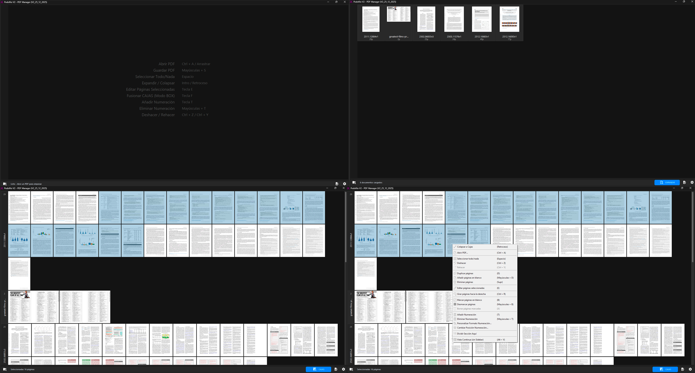

# Podofilo V2 - Gestor de PDFs para Extranjería (Open Core)

## Descripción
Podofilo V2 es una modernización completa de la aplicación original, reconstruida con Python 3.12+ (compatible con 3.14) y librerías modernas. Diseñada como una herramienta de "núcleo abierto" (Open Core), permite la gestión avanzada de documentación de expedientes de extranjería, con capacidad de extenderse mediante plugins para integraciones específicas (como el sistema OVE).



## Arquitectura Open Core
Esta versión introduce una arquitectura modular que separa el núcleo de la aplicación de las integraciones propietarias:

*   **Modo Open (Público):** Funciona como un potente gestor y organizador de PDFs sin dependencias externas. Ideal para uso general.
*   **Modo Full (Privado):** Al añadir el plugin `src/extensions/ove`, se activan las funcionalidades de conexión con la Sede Electrónica (OVE), descarga y subida de expedientes.

## Stack Tecnológico

| Componente | Tecnología | Descripción |
|------------|------------|-------------|
| **UI** | CustomTkinter + tkinterDnD2 | Framework moderno con soporte drag-drop |
| **PDF** | PyMuPDF (fitz) | Manipulación de PDFs sin DLLs externas |
| **Imágenes** | Pillow + Cache LRU | Procesamiento de thumbnails de alto rendimiento |
| **Plugin OVE** | Playwright + httpx | Automatización robusta y asíncrona (Solo modo Full) |

## Funcionalidades Principales

### Gestión de PDFs (Núcleo)
- **Grid Virtualizado**: Rendimiento fluido con cientos de páginas.
- **Zoom Instantáneo**: Sistema de caché multi-nivel con precarga inteligente.
- **Edición**: Rotar, duplicar, insertar blancos, eliminar.
- **Organización**: Sistema de Cajas (Staging Area) y Secciones.
- **Efecto Abanico**: Visualización de arrastre estilo V1.
- **Split Visual**: Dividir documentos desde el editor o mediante atajos.
- **Numeración**: Estampado de números de página configurable.
- **Vigilancia**: Importación automática desde carpeta (compatible con "Imprimir a PDF").

### Integración OVE (Solo con Plugin)
- **Descarga Masiva**: Obtención de expedientes completos (Ctrl+O).
- **Subida Inteligente**: Detección de número de expediente y subida directa (Ctrl+S).
- **Firmas**: Soporte para tipos de firma y conexión con portafirmas.
- **Auto-conexión**: Gestión de credenciales seguras y reconexión automática.

## Instalación y Uso
Ver [QUICKSTART.md](QUICKSTART.md) para instrucciones detalladas de instalación.

## Estructura del Proyecto
```
podofilo_v2/
├── main.py                    # Punto de entrada
├── requirements.txt           # Dependencias
├── src/
│   ├── core/                  # Lógica central y Extension Loader
│   ├── ui/                    # Interfaz de usuario
│   ├── pdf/                   # Motor de procesamiento PDF
│   └── extensions/            # Carpeta de Plugins
│       └── ove/               # (Privado) Código de integración OVE
└── ...
```

## Notas de Versión Recientes
### V2 (14 de Enero 2026)
- **Mejoras de UX en Menús**: Deshabilitación dinámica de las opciones "Subir al OVE" y "Modo Corte" en el menú contextual y atajos de teclado cuando no hay documentos cargados, mejorando la coherencia de la interfaz.
- **Actualización de Versión**: Sincronización de etiquetas internas para reflejar la versión estable actual.

### V2.UI/UX & Fixes (Enero 2026)
- **Mejora Visual de Secciones**: Implementación de encabezados con efecto de cristal (glassmorphism) e identificadores laterales cromatizados para facilitar la distinción entre documentos.
- **Corrección de Estado (Undo)**: Se ha corregido el comportamiento del sistema de deshacer (`Ctrl+Z`) para evitar cambios de vista accidentales tras operaciones de corte o división.
- **Refactorización Core**: Limpieza de dependencias y optimización del cargador de extensiones para un arranque más limpio en entornos sin el plugin OVE.

### V2.OpenCore (Diciembre 2025)
- **Separación de Código**: Aislamiento total del código OVE en su propia extensión.
- **Carga Dinámica**: Adaptación automática de la interfaz según los componentes disponibles.

### V2.Optimización (Diciembre 2025)
- **Rendimiento**: Implementación de zoom instantáneo y reducción del tiempo de inicio a menos de 3 segundos.
- **Estabilidad**: Corrección de fallos de enfoque y parpadeos en el grid virtualizado.

## Licencia
Este proyecto está licenciado bajo la **GNU General Public License v3.0**.
Consulte el archivo [LICENSE](LICENSE) para ver el texto completo de la licencia.